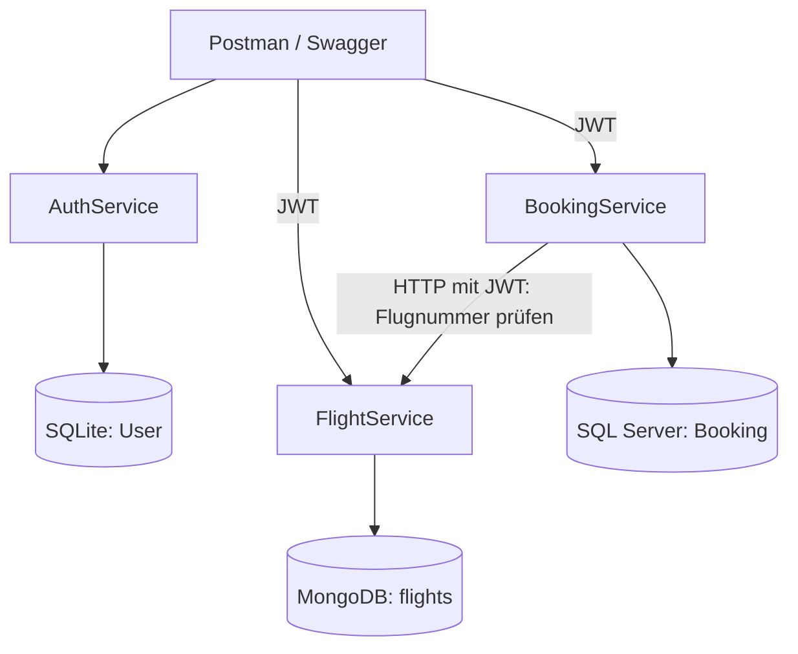

# Architektur und Datenmodell

Projekt: **Felipe Carvalho · SkyBooker**

## Dienstgrenzen

Ein Dienst greift nicht direkt auf die Datenbank eines anderen Dienstes zu. Das Shared-Projekt kapselt JWT-Validierung, Swagger, Fehlerbehandlung und Logging. Jeder Dienst hat eigene Controller, DTOs, Validatoren, Fachlogik und einen DbContext.

## Anfrageablauf

1. Registrierung speichert den Passagier in SQLite. Der Passwort-Hasher erzeugt für jedes Passwort einen individuellen Salt.
2. Login verifiziert den Hash und gibt ein HS512-signiertes JWT mit Benutzer-ID im `sub`-Claim zurück.
3. FlightService prüft Signatur, Issuer, Audience und Gültigkeit vor dem Controller-Aufruf.
4. BookingService prüft zusätzlich, ob die angegebene PassengerId zur Token-Identität passt.
5. Sein typisierter `HttpClient` fragt `GET /api/flight/by-number/{flightId}` ab und leitet das Benutzer-JWT weiter.
6. Nur bei vorhandenem, zukünftigem Flug speichert der BookingService die Buchung in SQL Server.

HTTP-Zeitlimit: 5 Sekunden. Ein nicht erreichbarer Dienst ergibt 503. Eine unbekannte Flugnummer oder ein vergangener Flug ergibt 422. In beiden Fällen entsteht keine Buchung.

## Datenmodell gemäss Auftrag

### FlightService: MongoDB, Collection `flights`

| Auftragsfeld / API | Speicherung | Typ / Verhalten |
| --- | --- | --- |
| `id` | `_id` | Automatisch generierte MongoDB-ObjectId; API liefert die 24-stellige Zeichenfolge |
| `flightId` | `flightId` | Eindeutige Flugnummer, 2–12 Grossbuchstaben/Ziffern |
| `airlineName` | `airlineName` | Text, maximal 100 Zeichen |
| `source` | `source` | Abflugort |
| `destination` | `destination` | Zielort, muss vom Abflugort abweichen |
| `departure_time` | `departure_time` | UTC-Zeitpunkt |
| `arrival_time` | `arrival_time` | UTC-Zeitpunkt nach dem Abflug |
| `available_seats` | `available_seats` | Zahl zwischen 0 und 1000 |
| `created_at` | `created_at` | Vom Server gesetzter UTC-Zeitpunkt |
| `updated_at` | `updated_at` | Beim Erstellen identisch zu `created_at` |

MongoDB verwendet für seinen Primärschlüssel nativ `_id`; das logische Auftragsfeld `id` wird darauf abgebildet. Es handelt sich um eine automatisch erzeugte ObjectId, nicht um eine fortlaufende SQL-Identity. `[BsonElement]` hält die vorgegebenen übrigen Feldnamen ein. Ein eindeutiger Index schützt `flightId` auch bei parallelen Anfragen. Die Flugnummer bezeichnet in dieser Schulumsetzung einen konkreten Flugeintrag; Serienflüge benötigen ein erweitertes Modell.

Alle Flug-Lese-/Schreibzugriffe verwenden den offiziellen MongoDB-Provider für EF Core. Nur die Verwaltung des eindeutigen Datenbank-Indexes und der Healthcheck nutzen direkt den MongoDB-Treiber. Pro Flugoperation wird ein Dokument geschrieben. Deshalb sind für diese Umsetzung keine Multi-Dokument-Transaktionen und kein Replica Set erforderlich.

### BookingService: SQL Server, Tabelle `Booking`

| Feld | Typ / Verhalten |
| --- | --- |
| `Id` | `int`, Identity-Primärschlüssel |
| `FlightId` | `nvarchar(12)`, durch HTTP validierte Flugnummer |
| `PassengerId` | `int`, muss zum JWT-`sub` passen |
| `PassengerFirstname` | `nvarchar(100)` |
| `PassengerLastname` | `nvarchar(100)` |
| `TicketCount` | `int`, 1–1000; zusätzlich SQL-CHECK-Constraint |
| `CreatedAt` | `datetime2`, UTC |
| `UpdatedAt` | `datetime2`, UTC |

Es gibt bewusst keinen datenbankübergreifenden Fremdschlüssel. PassengerId und FlightId sind Referenzen über Dienstgrenzen. Die existierende Benutzer-ID stammt aus dem verifizierten JWT. Die API liefert nur Buchungen der eigenen PassengerId, auch beim Listen-Endpunkt.

### AuthService: SQLite, Tabelle `User`

| Feld | Typ / Verhalten |
| --- | --- |
| `Id` | Integer-Primärschlüssel, automatisch erzeugt |
| `Username` | Text, eindeutiger Index ohne Unterscheidung von Gross-/Kleinschreibung |
| `EMail` | Text, eindeutiger Index, normalisiert gespeichert |
| `Password` | Passwort-Hash mit eingebettetem Salt und Algorithmusinformationen |

Passwörter werden nicht reversibel verschlüsselt: Für eine Anmeldung ist ein gesalzener Hash fachlich die passende Umsetzung. Die API gibt das Password-Feld niemals zurück. Benutzer-DTOs enthalten nur ID, Username und EMail. Es gibt keine vorgegebenen Benutzer und keine Registrierungsrolle im Request.

## API-Vertrag

| Dienst | Methode und Route | Erfolg | Typische Fehler |
| --- | --- | --- | --- |
| Auth | POST `/api/register` | 201 | 400, 409 |
| Auth | GET `/api/login`, HTTP Basic | 200 | 400, 401 |
| Auth | POST `/api/login`, JSON | 200 | 400, 401 |
| Flight | POST `/api/flight` | 201 | 400, 401, 409 |
| Flight | GET `/api/flight` | 200 | 401 |
| Flight | GET `/api/flight/{id}` | 200 | 400, 401, 404 |
| Flight | GET `/api/flight/by-number/{flightId}` | 200 | 401, 404 |
| Booking | POST `/api/booking` | 201 | 400, 401, 403, 422, 503 |
| Booking | GET `/api/booking` | 200 | 401 |
| Booking | GET `/api/booking/{id}` | 200 | 401, 404 |

Die Tabelle benennt fachliche Antworten; unerwartete Serverfehler ergeben zusätzlich ein ProblemDetails-Objekt mit 500 und Trace-ID. Swagger beschreibt DTOs, Authentifizierung und deklarierte Antwortcodes.

## Zwei optionale Anforderungen

**AO1, Logging:** Serilog schreibt strukturierte JSON-Ereignisse auf die Konsole. Jedes Ereignis enthält den Dienstnamen. Request-Methode, Pfad, Statuscode und Laufzeit sowie Registrierungs-, Login-, Flug- und Buchungsereignisse sind sichtbar. Request-Bodies, Authorization-Header, Passwörter und Tokens werden nicht protokolliert. Docker begrenzt die Logdateien auf drei Dateien zu je 10 MB.

**AO4, Dienstkommunikation:** `IFlightClient` trennt die HTTP-Validierung von der Buchungslogik. Der tatsächliche Client übernimmt Bearer-Weitergabe, Statusprüfung, Zeitlimit und JSON-Auswertung. Tests prüfen auch Ausfälle.

## Grenzen und Weiterentwicklung

- AO5 (Überbuchungsschutz) wurde nicht gewählt. Die aktuelle Buchung reduziert keine Sitzplätze. Dafür wäre eine atomare Reservierungsoperation im FlightService und ein definierter Kompensationsablauf nötig.
- Jeder authentifizierte Benutzer darf Flüge anlegen, entsprechend der JWT-Anforderung. Eine Admin-/Passagier-Rollentrennung ist eine mögliche weitere Erweiterung.
- Das Projekt enthält die geforderten Erfassungs- und Lese-Endpunkte. Stornierungen, Änderungen, Zahlungen und E-Mail-Bestätigung sind kein Bestandteil des Auftragsumfangs.
- JWTs laufen nach 15 Minuten ab. Es gibt hier keine Refresh-Tokens oder Widerrufsliste. JWT-Nutzlasten sind lesbar, die Signatur schützt ihre Integrität.
- Die lokale Entwicklungsumgebung verwendet Loopback-HTTP und Datenbank-Zugangsdaten in ignorierten Dateien. Vor einem öffentlichen Betrieb sind HTTPS, geeignete Datenbank-Berechtigungen und ein Secret Store erforderlich.
- EF Core erstellt die initialen Datenbanken mit `EnsureCreated`. Für spätere Schemaänderungen an bestehenden Daten ist ein geplanter Migrationsweg nötig; ein normales Neubauen ändert bestehende Tabellen nicht automatisch.
